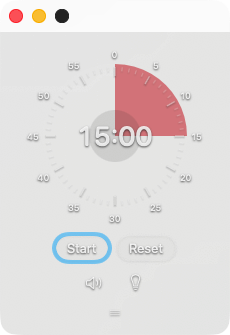

# POMODORO Timer

A small native macOS timer. Drag the dial to set the time, then press Start.



- Focus and break sessions, with pause and reset
- Optional completion sound and blinking, controlled below the dial
- Transparent smoky glass window and a menu bar timer
- Keep on top, close and reopen without losing your session
- Local storage only. No accounts, task integration, network requests or dependencies.

Requires macOS 14 or later and Swift 5.9 or later (Xcode command line tools).

```sh
swift test
./scripts/build-app.sh
open "artifacts/POMODORO Timer.app"
```

Closing the window leaves the timer in the menu bar. Quit from its menu. A finished session prepares the next phase and waits for you to start it. Sound and blink are off by default. Dragging while running pauses and replaces the duration. The dial shows a 60-minute scale by default; larger saved durations use a larger scale.

Settings and the timer are saved in `~/Library/Application Support/POMODORO Timer/state.json`. A running countdown uses its deadline across relaunch and sleep. The app must be running and the Mac awake for an immediate completion cue. An expired timer found on launch advances silently to the next phase. Invalid state files are preserved and changes disabled.

The app icon is drawn with AppKit; regenerate it using `swift scripts/render-icons.swift`. The menu bar uses a monochrome version. No analytics or external services.

Source: [github.com/Frozillamania/pomodoro-timer](https://github.com/Frozillamania/pomodoro-timer). Project page: [systemerror.app/products/pomodoro](https://systemerror.app/products/pomodoro/).

Build it locally using the commands above. Prebuilt signed/notarized downloads are not provided. No reuse license has been selected.

Native smoke (requires already-granted Accessibility and screen capture access): `./scripts/native-smoke.sh`. It uses a separate app identity and temporary state; it never opens your daily timer data.

Changing the system clock backward can make a saved deadline fail validation. The file remains untouched; use a backup or move it aside to recover. Full release QA and distribution signing remain outstanding.
